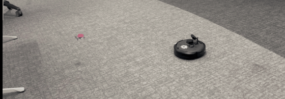
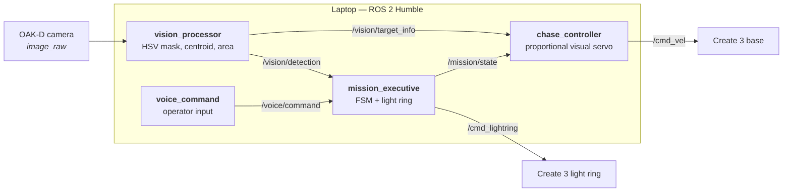
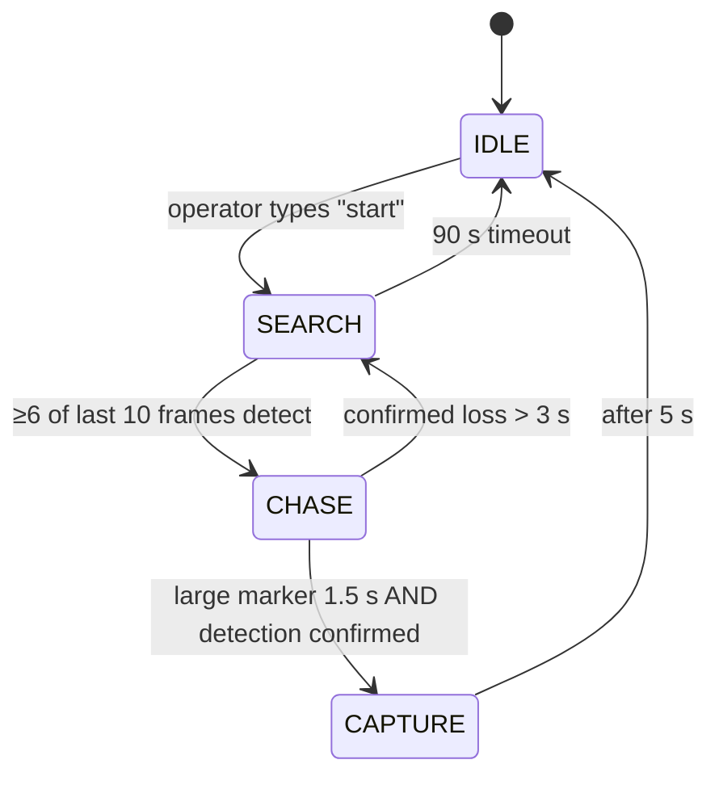

# Cyber-Cat — vision-only air–ground pursuit

A TurtleBot 4 hunts a Crazyflie drone across a lab floor using nothing but a
single RGB camera. No depth sensor, no motion capture, no shared map — the
ground robot infers *where* the target is from pixel position and *how far* it
is from apparent size, and that is the entire sensing stack.



ROS 2 Humble · Python · Ignition Gazebo · real hardware
(TurtleBot 4 + Crazyflie 2.x) · Northeastern University, Spring 2026

---

## The problem

Two robots with nothing in common. The Crazyflie has 27 grams of lift budget
and no room for a radio link to the ground robot. The TurtleBot has an OAK-D
camera but no reliable depth on a fast-moving 5 cm target. There is no shared
coordinate frame between them and no external tracking system.

So the robots are coupled through the physical world only: the drone flies, the
TurtleBot looks at it, and every quantity the controller needs is recovered
from one 2D image.

| What the controller needs | Where it comes from |
|---|---|
| Target bearing | Marker centroid's horizontal position in frame (`norm_cx`) |
| Target range | Fraction of frame the marker occupies (`area_ratio`) |
| Target presence | Rolling vote over the last 10 frames |

That substitution — apparent size standing in for metric range — is what makes
a monocular chase work without ever calibrating a depth model.

## Architecture



The drone is deliberately **outside** the ROS graph. `cflib` runs its own link
and callback threads that deadlock against an `rclpy` executor in a shared
process, so the Crazyflie flies from a standalone script over a Crazyradio
dongle. Discovering that cost a day; the workaround is one of the cleaner
parts of the design, since it forces the two robots to stay honestly decoupled.

### Mission state machine



Each state drives the Create 3 light ring a distinct colour — white, blue,
yellow, flashing green. That sounds cosmetic and turned out to be the single
most useful debugging tool in the project: you cannot read a terminal while
jogging after a robot, but you can see what state it thinks it is in from
across the room.

## Engineering decisions worth reading

**Range without a range sensor.** Forward speed is a function of
`area_ratio` across three zones: full speed below 0.007, a linear ramp to zero
between 0.007 and 0.018, zero above. The robot settles into a standoff
distance without ever knowing that distance in metres. The ramp — rather than
a threshold — is what stops the lurch-and-brake oscillation the first version
had.

**Hysteresis beats filtering.** Single-frame detection on real hardware
flickers constantly: motion blur, a passing shadow, the drone briefly edge-on.
An early version transitioned on individual frames and thrashed between SEARCH
and CHASE several times a second. The fix is a 10-frame rolling window where
entering CHASE needs ≥6 hits and declaring loss needs <2 — two different
thresholds, so the machine cannot sit on an edge.

**The grace period must not coast.** When detection drops mid-chase, the
controller holds the last known bearing for 1 s before giving up. The first
implementation also held the last *forward speed*, which drove the robot blind
into furniture. Turning toward the last bearing at zero forward speed keeps the
target recoverable without betting on a stale world model.

**Capture needs two independent signals.** `area_ratio` alone spikes for a
single frame whenever the robot yaws past something pink-ish, or the drone
crosses close to the lens on its way elsewhere. Requiring a large area *and* a
confirmed rolling-window detection, sustained for 1.5 s, eliminated every false
capture.

**Marker choice outranked detector tuning.** The system was built around a
green ball and kept locking onto lab clutter and driving into walls
([footage](docs/media/green_marker_failure.mp4)).
Narrowing the HSV thresholds suppressed the false positives but shrank the
detection range until the real target was lost too. Switching the ball to pink,
a hue essentially absent from that room, fixed it outright — and because the
thresholds are live ROS 2 parameters, recalibrating took minutes with no
rebuild. The lesson generalises: changing what you are looking at can beat
improving how you look.

**HSV in NumPy, not OpenCV.** Conversion is ~25 lines of vectorised NumPy
following OpenCV's 0–180 hue convention, so parameter values stay portable. It
removed an OpenCV dependency from the laptop image and runs comfortably inside
the camera's frame budget.

## Results

Measured on a physical TurtleBot 4 (`turtlebot468`) and a Crazyflie 2.x with a
Flow deck, over WiFi in a shared university lab.

| Behaviour | Result |
|---|---|
| Target centring | Smooth proportional turning, no visible oscillation |
| Distance regulation | Consistent standoff, smooth deceleration into the brake band |
| Short detection loss (<1 s) | Rides through flicker, no state thrash |
| Long detection loss | Falls back to SEARCH, reliably re-acquires |
| False positives after pink switch | None observed |
| Flight patterns tracked | Circle (r 0.6–0.8 m), figure-8 (r 0.6 m), square (0.7 m) |

**The honest limit: detection fails above roughly 0.5 m drone altitude.** The
marker's pixel area falls below the detection floor before the 1.0 m target in
the original proposal. This is inherent to area-based ranging with a small
marker — the right fix is the OAK-D's depth stream for metric range, decoupling
standoff from apparent size entirely, which is the first thing I would build
next.

Full demo: [`docs/media/pursuit_demo.mp4`](docs/media/pursuit_demo.mp4) ·
Failure case: [`docs/media/green_marker_failure.mp4`](docs/media/green_marker_failure.mp4) ·
Write-up: [`docs/final_report.pdf`](docs/final_report.pdf)

## Running it

### Simulation (no hardware needed)

```bash
source /opt/ros/humble/setup.bash
colcon build --packages-select cyber_cat --symlink-install
source install/setup.bash
ros2 launch cyber_cat ignition_simulation_launch.py
```

Spawns both robots in the Ignition arena, bridges the Gazebo topics, and starts
the behaviour nodes on an 8 s delay so they do not publish into a half-loaded
world.

### Real TurtleBot 4

Laptop and robot must share a network and a `ROS_DOMAIN_ID`.

```bash
# Terminal 1 — perception, state machine, controller
ros2 launch cyber_cat real_robot_launch.py

# Terminal 2 — operator input; type "start" or "stop"
ros2 run cyber_cat voice_command
```

### Crazyflie (standalone, over Crazyradio)

```bash
python3 scripts/crazyflie_flight.py circle --height 0.5
python3 scripts/crazyflie_flight.py eight --radius 0.6 --repeat 3
python3 scripts/crazyflie_flight.py square --side 0.7
python3 scripts/crazyflie_flight.py manual     # arrow keys, l to land
```

Ctrl-C lands the drone rather than cutting motors.

### Retuning detection without a rebuild

Every HSV threshold is a live ROS 2 parameter — this is how the green-to-pink
switch was done in minutes rather than a build cycle:

```bash
ros2 param set /vision_processor hue_low 140
ros2 param set /vision_processor hue_high 170
ros2 param set /vision_processor sat_min 50
ros2 param set /vision_processor val_min 80
ros2 param set /vision_processor min_target_pixels 25
```

## Layout

```text
src/cyber_cat/
├── cyber_cat/
│   ├── vision_processor_node.py    # HSV marker detection, centroid + area
│   ├── mission_executive_node.py   # FSM, hysteresis, light ring
│   ├── chase_controller_node.py    # proportional visual servo
│   ├── voice_command_node.py       # operator command input
│   └── crazyflie_patrol_node.py    # simulated drone target (sim only)
├── launch/
│   ├── real_robot_launch.py        # hardware; carries the tuned parameters
│   ├── ignition_simulation_launch.py
│   └── cyber_cat_launch.py         # behaviour nodes only
├── config/simulation_params.yaml   # topic overrides for the sim arena
└── models/, worlds/                # Ignition arena and robot models

scripts/
└── crazyflie_flight.py             # cflib flight patterns (outside ROS)

docs/                               # report, demo video, failure case
```

Hardware-tuned values live in `real_robot_launch.py` rather than a YAML, so the
numbers that make the robot behave are visible at the point of launch.

## Known limitations

- **0.5 m altitude ceiling** on detection, as described above.
- **Single-target.** The detector takes the centroid of all matching pixels; two
  pink objects in frame average into a phantom target between them.
- **No obstacle avoidance.** The controller drives straight at the bearing. The
  TurtleBot's lidar is bridged but unused — Nav2 as a pursuit fallback is the
  natural next step.
- **CAPTURE returns to IDLE**, so the operator restarts each run. Looping
  straight back to SEARCH would make it continuous.

## Stack

ROS 2 Humble · Python 3.10 · NumPy · Ignition Gazebo · `cflib` ·
`irobot_create_msgs` · TurtleBot 4 (Create 3 + OAK-D) · Crazyflie 2.x + Flow deck

---

Built for a graduate robotics course at Northeastern University. I owned the
system architecture, the mission state machine, the vision pipeline, the chase
controller, and the hardware bring-up and tuning. Teammates Wei Yun Feng,
Ruiling Jin, Ching-Hsin Hsu and Zhixuan Fu contributed to the Crazyflie flight
scripts, the simulation arena, and test runs.

MIT licensed — see [LICENSE](LICENSE).
